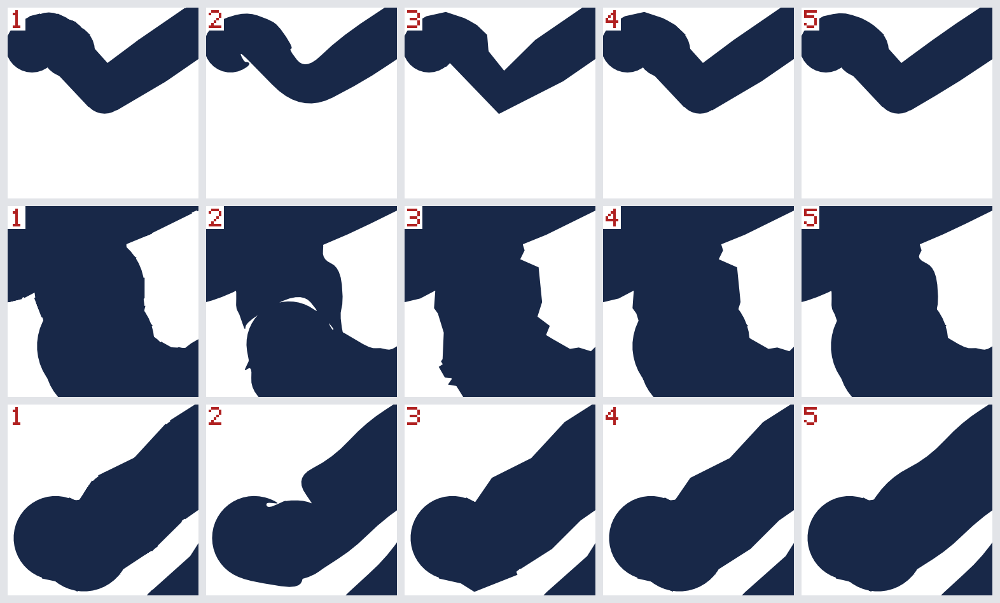

# Spike slice 3, part d: lighter outline forms that leave no holes

Date: 2026-11-13. Code: `crates/everink-core/src/outline.rs` (`build_runs`, `build_runs_within`), its tests in
`crates/everink-core/tests/outlines.rs`, and `spike/render-trial` and `spike/render-web`, which draw the new forms.
Design: [`../design/06-rendering-and-ink.md`](../design/06-rendering-and-ink.md), "The outline: variable width,
deterministic".

Slice 3 left two outline forms and a gap between them. The design's single path is light and leaves holes where a
stroke doubles back or curls ([3a](results-3a-wasm-outlines-cut.md)). Discs and bands leave none and cost the
renderer about six times as much ([3b](results-3b-renderer.md), [3c](results-3c-browser.md)). On 2026-11-13 the
owner chose to have the lighter hole-free forms built and measured before choosing. This part does that. It
chooses nothing: the outline form is the owner's decision.

## Answer

**There is a form that leaves no holes and costs the renderer 1.2 to 1.4 times what the single path does, where
discs and bands cost 6.5 times.** It is called *runs* here. A stretch of the stroke that turns gently is one
closed path, as in the single path; where that path would fold over itself, the stretch ends and another begins.
Its golden file, written on aarch64, passes byte for byte on wasm32 and, in CI, on x86-64.

| | Single path (the design's) | Discs and bands (3a) | Runs, sides smoothed |
|---|---|---|---|
| Holes over the stroke | yes | none | none |
| Segments a stroke, the trial's scene | 165 | 1,485 | 259 |
| Redraw of 10,000 strokes, natively, `vello_cpu` | 61.6 ms | 398 ms | 88.0 ms |
| The same in Chrome, with SIMD | 80.6 ms | 536 ms | 115 ms |
| One tile of 327 strokes in Chrome | 2.0 ms | 13.4 ms | 2.9 ms |
| Same bytes on aarch64, x86-64 and wasm32 | yes | yes | yes |

- **Three variants of runs were built**: a run ended where the stroke turns a quarter turn or more, the same at an
  eighth of a turn, and the second with the sides of each run smoothed as the single path's are. They cost within
  a quarter of one another. The picture below shows why the third is the one to look at: with straight sides a
  stroke looks cut from card when it is magnified, and a limit of a quarter turn leaves spikes at corners.
- **A true union was tried with a polygon-clipping library and is worse on every count**: 544 segments a
  stroke, 128 ms to redraw, and 1,641 microseconds to make one stroke's outline, against 7.9 for a
  longer and rougher stroke as runs.
- **Fewer and straighter corners** (octagons and bands) were measured in parts 3b and 3c: 889 segments, 262 ms.
  They do not close the gap.
- **Runs are not the same shape as discs and bands.** Where the pressure changes from one point to the next,
  runs taper straight between the two widths; discs and bands put a full disc on the heavier point. And at a
  turn inside a run the outer edge cuts the corner a little. On the trial's strokes runs cover 0.4% to 0.7% less
  area. Nothing is missing from the inside of a stroke.
- **One thing found on the way: the renderer draws discs and bands too heavy.** At 2 to 6 pixels wide, `vello_cpu`
  gives a stroke of discs and bands 110% of the coverage its shape has. The single path and runs are drawn at
  99.5% to 102%.

## What was built

### Runs

`everink_core::outline::build_runs_within(points, base_width, min_cos, smooth)`, and `build_runs`, which is the
first variant.

A stroke's centre line is the same as for the other two builders: the points, less repeats, each with a radius
from its pressure. A **cross-cut** at a point is a pair of corners, one on each side, at the radius. Between two
cross-cuts lies a **piece** with four corners. A piece is **sound** if it is a convex four-cornered shape going
anticlockwise; that is worked out on the outline lattice in whole numbers, so the answer is the same on every
machine.

A **run** is a chain of sound pieces drawn as one closed path: the right-hand corners forward, the left-hand
corners back. Inside a run, the cross-cut at a point leans with the turn there (it is on the normal of the two
pieces taken together), which is the single path's corner. The builder walks the stroke and keeps a run going
while the turn is under the limit and the next piece is sound. Otherwise:

- If the turn is under the limit and a piece is not sound, the run ends flat at that point and a new one begins,
  square to its first piece. A **wedge**, a triangle of the point and the two outer corners, fills the gap the two
  flat ends leave on the outside of the turn. This is what happens along the inside of a tight curl under a wide
  brush, where the single path folds over and leaves its holes.
- If the turn is at the limit or over it, the same, with a **disc** as in discs and bands and no wedge.
- The stroke's two ends have a disc each.

**Why there are no holes.** A run's path is the sum of the edges of its pieces: the cross-cuts between
neighbouring pieces are walked once each way and cancel. So the path winds once round every point of every piece
and never the other way. Wedges and discs go the same way round. Under the non-zero rule a point is filled if
the paths wind round it at all, and no path here can take away what another gives. That is the reason discs and
bands have no holes, and it carries over.

**Smoothed sides.** With `smooth`, a corner inside a run becomes a curve from the middle of one edge to the
middle of the next, with the corner as control point; this is how the single path is smoothed. The curve takes a
sliver off the outside of the turn, so a run no longer covers its pieces exactly, and the argument above holds
only up to those slivers. To keep them away from the middle of the stroke, a corner stays sharp where the
stroke's own point is not on the far side of the chord the curve replaces. The ends of a run, the wedges and the
discs are as before.

**What a run costs.** Two segments a point where the stroke is gentle. Seven a point (a four-cornered piece and
a wedge) where the brush is so much wider than the step between points that the inner side folds at every
point. Discs and bands cost twenty a point, sixteen of them curves.

### In the trials

`spike/render-trial` and `spike/render-web` draw three more forms, the three variants. The native trial has
three more runs:

- `coverage [strokes]` compares what each form covers with what discs and bands cover, a stroke at a time. It
  uses no renderer: each path is flattened to a thousandth of a pixel and cut by sample rows, eight a pixel, and
  along each row the covered stretches are exact. It also draws each stroke alone with `vello_cpu` and sets the
  coverage drawn against the shape's own area.
- `union [strokes]` replaces each stroke's discs and bands by their true union, made by `i_overlay` 9.1.0, and
  draws the view from that. It is for this trial only, in pixels of one zoom.
- `picture <file.png>` writes the picture below.

The browser trial keeps the tiles of the last form it drew as its cache. It used to label that check with the
third form's name, which was right only while there were three; it now names the last.

## Measurements

Machine: Apple M4, macOS. The scene is the one of parts 3b and 3c: 10,000 strokes, random walks of 30 to 120
points, 2 to 6 pixels wide at 256 pixels a unit, over a 3840 x 2160 view in 40 tiles of 512 pixels. "Rough
strokes" are the same with a sharp turn, a doubling back, a hairpin or a pause at about one point in fifteen.
In both, the pressure changes at random from point to point, which no pen does; "steady" strokes have one
pressure.

### Segments

| Form | The scene, a stroke | Rough strokes, a stroke | The core's test corpus, 1,000 strokes |
|---|---|---|---|
| Discs and bands | 1,485 | 1,504 | 2,736,720 |
| Octagons and bands (the trials only) | 889 | 901 | not built in the core |
| Single path | 165 | 196 | 346,997 |
| Runs, cut at a quarter turn | 201 | 301 | 945,380 |
| Runs, cut at an eighth | 214 | 349 | 1,015,291 |
| Runs, cut at an eighth, sides smoothed | 259 | 390 | 1,052,764 |
| True union (the trial only; all straight) | 544 | | |

The test corpus is the hard case for runs: its brushes are up to 80 times as wide as the step between points,
so the inner side folds at almost every point and nearly every piece is a run of its own (180,328 paths for
140,838 points). Runs are still 35% to 38% of discs and bands there.

### What each form covers

300 strokes, each compared with its own discs and bands (`render-trial coverage 300`). "Inside" is the same
stroke built a tenth, and three tenths, thinner as discs and bands: what a form does not cover of that is
missing well inside the stroke, not at its edge. A stroke is counted if more than a thousandth of a square
pixel is missing.

| Strokes | Form | Area more | Area less | Missing a tenth inside | Missing three tenths inside |
|---|---|---|---|---|---|
| The scene's | Single path | 0.34% | 0.71% | 0.010%, 106 strokes | 0.001%, 30 strokes |
| | Runs, quarter turn | 0.16% | 0.43% | 0.011%, 127 strokes | none |
| | Runs, eighth | 0.16% | 0.40% | 0.004%, 101 strokes | none |
| | Runs, eighth, smoothed | 0.09% | 0.74% | 0.004%, 101 strokes | none |
| Rough | Single path | 0.27% | 1.08% | 0.114%, 261 strokes | 0.011%, 106 strokes |
| | Runs, quarter turn | 0.14% | 0.66% | 0.067%, 224 strokes | under 0.0005%, 4 strokes |
| | Runs, eighth | 0.14% | 0.44% | 0.008%, 121 strokes | none |
| | Runs, eighth, smoothed | 0.08% | 0.74% | 0.008%, 122 strokes | none |
| Rough, steady pressure | Single path | 0.14% | 0.64% | 0.083%, 196 strokes | 0.008%, 63 strokes |
| | Runs, quarter turn | 0.10% | 0.38% | 0.050%, 181 strokes | none |
| | Runs, eighth | 0.10% | 0.19% | none | none |
| | Runs, eighth, smoothed | 0.03% | 0.36% | none | none |

Reading it:

- **The single path's holes show as area missing three tenths inside the stroke**, in a third of the rough
  strokes. Runs cut at an eighth have none there in any row.
- **What runs miss a tenth inside is the taper.** At a steady pressure, runs cut at an eighth miss nothing a
  tenth inside. With the pressure changing at random they do, in a third of the strokes, because discs and bands
  put a whole disc on a heavy point and runs do not.
- **A quarter turn is too loose a limit.** At a turn inside a run the outer edge is short of the round join by up
  to the radius times one minus the cosine of half the turn: 29% of the radius at a quarter turn, 7.6% at an
  eighth. The table shows it (four rough strokes miss area three tenths inside), and so does the picture.
- **Smoothing costs about a third of a percent of area** on these strokes, all of it at the edge.

Octagons and bands are left out of this table: the trial builds them with a pressure curve that is only near the
core's, so their area is not comparable.

### The picture

Parts of three rough strokes at 4096 pixels a unit, sixteen times the scene's zoom, drawn by `vello_cpu`
(`render-trial picture`). A row is one stroke. The columns, left to right: discs and bands; the single path;
runs cut at a quarter turn; runs cut at an eighth; runs cut at an eighth with their sides smoothed. The three
strokes are those, of the first 300 rough ones, where the single path leaves the longest stretch of the stroke's
inside uncovered, and each row is centred there.

- Column 2, the single path: a hole in the second row and a notch in the third, and its outline departs from the
  others where the stroke turns back.
- Column 1, discs and bands: whole, and lumpy, because every point's disc shows where the pressure changes.
- Column 3, runs cut at a quarter turn: whole, with a spike at the sharp corner of the first row and corners
  along the others.
- Column 4, runs cut at an eighth: whole, with straight sides.
- Column 5, the same smoothed: whole, and as smooth as the single path.

At the scene's own zoom these strokes are 2 to 6 pixels wide and the forms cannot be told apart by eye, but for
the holes. Everink zooms without limit, so the magnified look matters.

### Redrawing the whole view, 10,000 strokes

Natively (`render-trial 10000`), the median of five redraws after one that is not counted:

| Form | Segments a stroke | `vello_cpu` | ... a tile | `vello_gpu` (Metal) |
|---|---|---|---|---|
| Discs and bands | 1,485 | 398 ms | 9.9 ms | 425 ms |
| Octagons and bands | 889 | 264 ms | 6.6 ms | 296 ms |
| Single path | 165 | 61.6 ms | 1.5 ms | 82.5 ms |
| Runs, quarter turn | 201 | 71.6 ms | 1.8 ms | 93.1 ms |
| Runs, eighth | 214 | 74.5 ms | 1.9 ms | 98.2 ms |
| Runs, eighth, smoothed | 259 | 88.0 ms | 2.2 ms | 110 ms |
| True union (`render-trial union`) | 544 | 128 ms | 3.2 ms | not run |

In Chrome 157 on the same machine, the build with WebAssembly SIMD (the web build requires it; owner decision of
2026-11-13), one session in a fresh window with an empty profile:

| Form | `vello_cpu` | WebGL2 | WebGPU | One tile, `vello_cpu` |
|---|---|---|---|---|
| Discs and bands | 536 ms | 540 ms | 538 ms | 13.4 ms |
| Octagons and bands | 360 ms | 360 ms | 362 ms | 9.0 ms |
| Single path | 80.6 ms | 77.6 ms | 78.7 ms | 2.0 ms |
| Runs, quarter turn | 94.5 ms | 91.7 ms | 93.3 ms | 2.4 ms |
| Runs, eighth | 98.0 ms | 96.6 ms | 97.4 ms | 2.5 ms |
| Runs, eighth, smoothed | 115 ms | 115 ms | 115 ms | 2.9 ms |

The figures of the three forms measured before agree with part 3c (540, 358 to 363 and 80 to 81 ms there). The panning part of the page was left out of this session (`pan=no`): a first session with it did not finish, most likely because the window was not being shown, and a page that is not shown gets no animation frames. A session earlier the same day, on a busier machine, did run it over the tiles of runs: a median of 16.67 ms between frames on both backends, as in part 3c.

Section 06 budgets 4 ms of processor time a frame for tile raster. One tile of 327 strokes takes 2.0 ms in Chrome as the single path, 2.4 to 2.5 ms as runs with straight sides and 2.9 ms as runs with smoothed sides. So one whole tile of runs fits a 4 ms box where two of the single path's do: 40 frames (0.67 s) to redraw the whole view against 20 (0.33 s), and 135 (2.3 s) for discs and bands. Natively a tile of runs takes 1.8 to 2.2 ms and two fit.

The three renderers drew the same pixels for every form, as in part 3c: no pixel of the busiest tile differed by
more than an eighth of full coverage between any two.

### Making the outline

`cargo run --release --example bench_cut`: one stroke of 200 points, a random walk that changes direction and
pressure freely at every point (rougher than the scene), 2,000 builds, the median.

| Builder | Time | Segments |
|---|---|---|
| Discs and bands | 7.3 microseconds | 3,996 |
| Single path | 4.5 microseconds | 1,109 |
| Runs, quarter turn | 7.9 microseconds | 2,813 |

Runs take a little longer to build than discs and bands on this stroke: fewer segments, and a soundness test in
128-bit whole numbers for every piece. The outline of a stroke is built once, when the stroke is made or loaded,
not at every redraw.

### A true union

`render-trial union 10000`. Each stroke's discs and bands are flattened to a hundredth of a pixel at the scene's
zoom and handed to `i_overlay`, which returns the outline of their union under the non-zero rule.

- Making the unions: 1,641 microseconds a stroke, 16.4 s for the 10,000.
- 544 segments a stroke, all straight: the round outside of a stroke becomes many short edges.
- It covers what discs and bands cover: 0.027% less area over the first 300 strokes, none more.
- Redraw: 128 ms with `vello_cpu`.

It was not taken further. It is heavier than runs to draw, takes some two hundred times as long to make, and
is made for one zoom; an outline for every zoom would need curves or finer edges, so more segments. Whether the
library gives the same bytes on every machine was not looked at.

## Findings

1. **Runs close the gap slice 3 found.** No holes, by construction and on every stroke tested, at 1.2 (straight sides) to 1.4 (smoothed)
   times the single path's redraw time natively and the same in Chrome, where discs and bands are at 6.5 and
   6.6 times.
2. **The limit on a turn should be an eighth, not a quarter.** It costs 3 ms in 72 natively and removes the spikes
   and the area missing inside the stroke.
3. **Smoothed sides are what make runs look like ink when magnified.** They cost 13.5 ms in 74.5 natively and 17 ms in 98 in Chrome, a little under a fifth. They also
   weaken the argument for "no holes" from exact to "exact but for slivers at the outside of turns, kept away
   from the centre line"; the tests check the centre line with the curves followed.
4. **Runs change the shape of a stroke where the pressure changes.** They taper; discs and bands bulge. Neither
   is what section 06 specifies in so many words: its single path tapers too. If runs are chosen, the taper is
   the shape, and the cut (slice 3a), the hit test and the eraser must agree with it.
5. **Under a very wide brush runs lose most of their advantage** (the test corpus: 35% to 38% of discs and bands,
   not 14%). A marker many times wider than the step between its points would be better served by leaving out
   points that add nothing, which no builder here does.
6. **The renderer adds the coverage of overlapping parts of one path at their edges.** A stroke of discs and
   bands 2 to 6 pixels wide is drawn with 110% of its area; eight times as large, 100.3%. So the form built to be
   exact is the one drawn least exactly at ordinary sizes, and thin strokes drawn with it look bolder than they
   are. Runs overlap only at wedges, discs and self-crossings: 100.2% to 101.9%.
7. **A true union is not worth its cost here** (above).

## What this part does not show

- **Real pen strokes.** Every stroke here is a random walk with random pressure. Real strokes are smoother and
  their pressure changes slowly, which favours runs (longer runs, less taper), but that is not measured.
- **How it looks to a person at ordinary zoom**, beyond the one picture.
- **The live preview.** Section 06 wants the outline built as the stroke grows. A run can grow at its end; that
  entry point is not written.
- **Other browsers and a slower machine**, as in part 3c.
- **Sub-pixel and very large strokes**, and strokes cut by the eraser.
- **A proof for the smoothed variant.** The argument is given above with its limit; the test covers the centre
  line of 1,000 rough strokes at every eighth point, not every point of every stroke.

## Where the code departs from the design

1. Runs are a third builder beside the two of slice 3a, in `everink-core`, for the trial. None is "the" builder
   until the owner chooses.
2. The limit on a turn is passed as a cosine and compared with a dot product of unit directions, in floats like
   the rest of the outline arithmetic; the soundness of a piece is decided in whole numbers on the lattice.

## What the design should change

Nothing until the owner chooses. If runs are chosen, section 06's steps 4 to 8 describe them in place of the
single path, with the taper stated as the stroke's shape, and the performance budget takes the figures above.

## For the owner's choice

The forms on the table, with what each means:

| Form | Holes | Redraw, natively | In Chrome | Shape and look |
|---|---|---|---|---|
| Single path, as designed | yes | 61.6 ms | 80.6 ms | Smooth; holes where a stroke turns back or curls |
| Discs and bands | none | 398 ms | 536 ms | Exact union; lumpy where pressure changes; drawn 10% heavy at small sizes |
| Runs, eighth, straight sides | none | 74.5 ms | 98.0 ms | Tapers; straight edges show when magnified |
| Runs, eighth, smoothed sides | none | 88.0 ms | 115 ms | Tapers; smooth; "no holes" argued up to edge slivers and tested on the centre line |

## Kept afterwards

`build_runs` and `build_runs_within` stay in `everink-core` beside `build` and `build_single_path` until the
outline form is chosen; the builders not chosen go then, with their golden files. `spike/render-trial` stays as
part 3b left it.
