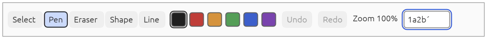
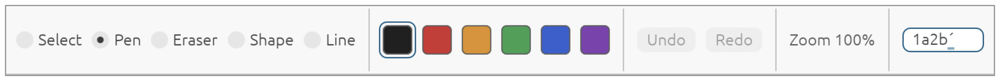

# Spike slice 4, part b (web): the two controls toolkits in a browser

Date: 2026-11-12. Code: `spike/controls-web`, with small changes to `spike/controls-window` and
`spike/controls-trial`. This closes part 4b of question 12 of [`README.md`](README.md): **which controls
toolkit?** The native half is [`results-4b-window.md`](results-4b-window.md). Here each candidate is drawn on
a canvas in a browser, behind the DOM mirror and the hidden textarea of section 07. The choice is the owner's;
nothing here makes it.

Unlike the native window, the page could be driven: Chrome's debugging protocol sends keys and text through the
browser's own input path, runs an input method's composition, and gives the accessibility tree the browser
makes. No person pressed a key. Everything below is from
Chrome 157 on an Apple M4 (macOS). Safari, Firefox and a phone are not tried, and no screen reader was heard.

## Answer

**One mirror and one textarea serve both candidates, and both pass every check**: 50 checks each, the same
script (`node spike/controls-web/check.mjs own`, and `egui`), five runs of each without a failure. The first
version of the script had 35 checks and both passed those too, but it missed three faults of the page that the
reviews of this change found, two of which showed only with egui; see "Faults the first checks missed".

| | Own toolkit | egui 0.37 |
|---|---|---|
| The browser's accessibility tree has the toolbar, the two radio groups, every button with its name and checked state, Undo disabled, the zoom figure, the named text field with its value | Yes | Yes |
| A pointer click reaches the control through the mirror over it | Yes | Yes |
| Every mirror element is found where its control is drawn (hit-tested at the control's middle) | Yes | Yes |
| A click on a mirror element (`element.click()`, standing in for a screen reader's activation) gives the command, and the tree follows; on a disabled button it gives nothing | Yes | Yes |
| Tab enters the controls from nothing and from the buttons before and after them, at the controls' first stop going forwards and their last going backwards; at every stop the DOM's focus and the controls' focus are on the same control | Yes | Yes |
| Tab past the last control, and Shift and Tab past the first, leave the controls | Yes | Yes, because the shell steps in: egui cycles its focus and never lets go |
| Typed characters go into the field once each, pasted text goes in, and the textarea holds the same text | Yes | Yes |
| A dead key: the accent is composed and is not in the value; the letter completes it, once | Yes | Yes |
| A composition given up leaves the field as it was | Yes | Yes |
| An input method composing in steps; its text goes in once | Yes | Yes |
| Enter in the field gives the colour | Yes | Yes |
| Keys that change no text rewrite no text in the mirror | Yes | Yes |
| Presses of Tab from the page to the field | 3 (Pen, Black, the field; Redo was disabled) | 12 (every radio button) |
| Escape | Lets go of the focus; nothing has it until the next Tab | The same |
| The right arrow on a focused tool | Focuses the next and chooses it | Focuses the next; chooses nothing |
| Composing a seventh character into the full field | Shown while composing | Not shown: egui counts composed text against the limit |

- **egui's hidden-input text agent is not used at all.** egui here is driven through the trial's own events,
  and the page's textarea is Everink's. The design's worry about that agent (its open issues on the web) does
  not arise in this arrangement; it would if egui's own web integration were used.
- **Most of the differences are part 4a's**, now seen through a browser: egui's Tab stops and arrows, and its
  limit counting composed text. Three are new, and each is something the shell had to do for egui and not for
  the own toolkit: see Findings 4 to 6.

## The pictures

Taken by the check, in Chrome, while a dead-key accent is being composed in the field.

The own toolkit:

egui:

They are the native pictures again: the same painters draw both, through `wgpu`'s WebGPU backend here.

## What was built

- **`spike/controls-web`**: a package of its own, outside the workspace, with its own lock file. A wasm module
  holds a candidate, draws it on the canvas, and gives the page the accessibility tree and the text field's
  state as JSON each frame. It builds `spike/controls-window`'s `paint.rs` and `shell.rs` in, so the native
  window and the page draw and behave from the same code.
- **The web shell** (`www/index.html`, 230 lines), as section 07 has it:
  - **The mirror.** One element for each control under a root with `role="application"`: `toolbar`,
    `radiogroup`, `radio` with `aria-checked`, `button` with `aria-disabled`, the zoom figure as plain text
    (not a live region), and the field as a real `<textarea>`. Names go in as attributes and text, never as markup. Each element is
    placed where its control is drawn, is not seen, and takes no pointer, so the canvas gets the pointer. A
    node that gives no bounds takes no room. Attributes and text are written only when they change.
  - **One focus.** The controls say where the focus is; the page moves the DOM's focus to that element and
    keeps it the only one in the tab order. Focus or a click arriving on a mirror element from outside (a
    screen reader) goes back to the controls as a request.
  - **Text.** `compositionupdate` becomes `Preedit`, `compositionend` becomes `Commit` (or a cancel when it
    is empty). `beforeinput` is cancelled; inserted, pasted, dropped and replacement text become a commit,
    and deleting a character or breaking the line becomes a key; every other kind (deleting a word, undo) is
    cancelled and nothing is done. A `keydown` during a composition is not forwarded. The textarea's value is set from the controls and never while composing.
- **The check** (`check.mjs`): serves the page, opens Chrome with an empty profile, and runs the script above.
- **In `spike/controls-window`**: the candidate, its painter and the toy document moved to `shell.rs`, shared
  with the page. **In `spike/controls-trial`**: the three small suggestions left by earlier reviews.

## Findings

1. **Section 07's web design works for both candidates as written.** A mirror kept from the AccessKit tree, a
   textarea as the text field, and the DOM's focus as the single focus: Chrome's accessibility tree is right,
   and keys, typing and composition are right, with either toolkit behind it.
2. **AccessKit's tree is enough to build the mirror from.** Role, label, value, toggled, disabled, bounds,
   children and the three actions were all the page needed. (AccessKit still has no web adapter; this is the
   one Everink writes.)
3. **`Input.imeSetComposition` drives a real composition in Chrome**, as the design hoped (it was unverified):
   it raises `compositionupdate` and `compositionend` on the textarea. The web text bridge can be tested
   without a person.
4. **Who moves the focus in and out is the shell's to settle, and a toolkit that cycles its focus needs the
   shell to let it out.** Left to the browser, the first Tab went to the first element in the mirror; the page
   hands that Tab to the controls, which start at the chosen tool. The own toolkit lets go of the focus past
   its last control. egui does not: Tab past the field goes round to the first tool, which in a page would trap
   the keyboard (WCAG 2.1.2). The shell sees the focus go the wrong way round, makes egui drop it, and lets the
   browser take the key.
5. **egui needs two frames for an event; the own toolkit one.** Some of egui's answers (a command, the focus
   after Shift and Tab) appear only in the frame after the one that took the event. A shell that draws once an
   event, as the page first did, shows egui one key behind. Both shells now always run two.
6. **egui gives no bounds for its container nodes** (the toolbar, the groups). The mirror must not size or clip
   by them; the page's first version did, and hid every one of egui's mirror elements.
7. **The page draws with WebGPU only.** The mirror and the textarea do not depend on it; the WebGL2 path of
   part 3c was not joined to the controls here.
8. **The module is 7.9 MB** raw with both candidates, both painters and their fonts, built for speed. It is
   not a size to compare with anything: part 4a measured each candidate's size alone.

## Faults the first checks missed

The first check script passed for both candidates while the page had these faults. The two independent reviews
of this change found them, by driving the page themselves:

- **Every one of egui's mirror elements was clipped to nothing**, because its groups have no bounds and the
  page gave them no size and clipped their contents. A screen reader's cursor, and explore by touch, would
  have found nothing for egui and everything for the own toolkit: the trial's fault, counted against a
  candidate. The script checked the elements' boxes, which were right, and not whether they could be hit.
- **With egui, Shift and Tab showed its result one key late** (Finding 5).
- **The element kept in the tab order when nothing had the focus caught Shift and Tab** on the way out; and,
  after that was fixed, Shift and Tab coming in from an element after the controls landed on it (the chosen
  tool) and not on the field, so the rest could not be reached backwards. The controls now choose the entry
  whichever way and from wherever Tab comes, and let go of their focus when the DOM's focus leaves the mirror
  by any other way (a click elsewhere, a script), which they did not before.
- **The zoom figure was a live region rewritten on every frame**, so a screen reader might have read it after
  every key.
- **Pasted text was cancelled and dropped.**
- **The script itself could measure nothing and pass**: Chrome does not deliver keys to a window that is not in
  front, and one result line was printed from a page that had received none. It now turns on Chrome's focus
  emulation and checks that the keys arrived.

Each now has a check. The lesson for section 07's tests is that boxes and trees are not enough: hit-testing,
both directions of Tab, and mutation of the mirror need checks of their own.

## What this part does not show

- **A screen reader.** Chrome's accessibility tree is what a screen reader is given, not what it says.
  VoiceOver, NVDA and the others are the owner's: five steps in `spike/controls-web/README.md`.
- **Explore by touch.** Whether a touch screen reader reaches mirror elements that lie over a canvas and take
  no pointer is the design's own open question, and is still open.
- **Safari and Firefox, a phone, a real keyboard's dead keys and a real input method.** The compositions here
  are Chrome's debugging protocol's.
- **The mirror turned on by a button**, the two live regions for announcements, the objects-in-view list:
  section 07 has them and the trial does not. The mirror is always on.
- **A value set from outside.** The controls take `SetValue`, but the page does not pass on a value that
  assistive technology or dictation writes into the textarea directly; the next frame overwrites it.
- **"Multi-line".** The field is a textarea, as section 07 has it, so the browser calls it multi-line; a
  screen reader may say so of a one-line field.
- **Scroll, zoom of the page, a narrow screen, right-to-left.**
- **The cost of keeping the mirror.** The page compares the mirror with the tree every frame and writes what
  changed; not measured.

## Where the code departs from the design

- The web shell is JavaScript in the page, not Rust: about 230 lines, there to be read.
- The mirror lies over the canvas (taking no pointer) and not under it.
- Tab is handled by the controls and the DOM's focus follows; section 07 has roving `tabindex` with the
  browser moving the focus. Both end with one element in the tab order.
- The tree crosses to the page as JSON, whole, every frame.

## What the design should change

With the earlier parts' corrections, in a separate change:

1. Section 07, tests: `Input.imeSetComposition` works; the web text bridge and the mirror can be tested in
   Chrome without a person, and the accessibility tree read with `Accessibility.getFullAXTree`.
2. Section 07, the mirror: say which side decides where Tab enters and leaves; a node may have no bounds;
   the shell runs a second frame for a toolkit that answers late; and the tests must hit-test the mirror, go
   both ways with Tab, and watch what is rewritten.
3. Section 07, candidates: egui's web text agent is not used when egui is driven through Everink's shell.

## Kept afterwards

`spike/controls-web` stays with the other two controls packages until the owner chooses.
