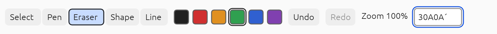
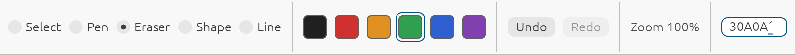
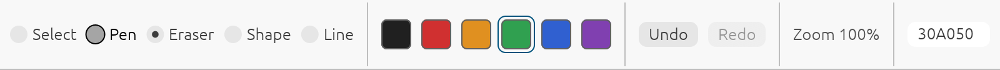

# Spike slice 4, part b (native): the two controls toolkits in a window

Date: 2026-11-12. Code: `spike/controls-window`, and small changes to `spike/controls-trial`. This is the second
part of question 12 of [`README.md`](README.md): **which controls toolkit?** Part 4a
([`results-4a-controls.md`](results-4a-controls.md)) compared the two candidates without a window. This part
puts each in a native window, so that the checks only a person can make become possible. The browser, with the
DOM mirror, is a further part and is not here. The choice is the owner's; nothing here makes it.

## What an agent could and could not check

| | Checked here | How |
|---|---|---|
| Both candidates draw the same toolbar on a GPU surface | Yes | A frame of each rendered to a picture by the same painters the window uses (below) |
| Each window opens and runs | Yes | Opened for six seconds each on an Apple M4, macOS; neither failed |
| The platform is handed the accessibility tree | Built, not exercised | `accesskit_winit` 0.34.2 is offered every frame's tree and takes it only while assistive technology is active, which it never was; nothing here reads the tree back from macOS, and no request ever came through the adapter |
| A screen reader reads it rightly | No | The owner's, with the script in `spike/controls-window/README.md` |
| A real keyboard and dead keys | No | The same: the shell maps winit's events as winit documents them, and no key was pressed |
| An input method's window at the caret | No | The shell would call `set_ime_allowed` and `set_ime_cursor_area` while the field has the focus; in a window the field never had it, so the calls were never made |
| Windows and Linux | No | Built on macOS only; CI builds it on Linux |

So this part's result is a tool and its first pictures, not a verdict. The script has fourteen steps for each
candidate.

## The pictures

Each after the same use: Eraser and Green chosen, the field focused, two characters deleted, `A` typed, and a
dead-key accent being composed. 1600 by 112 pixels (800 by 56 at a scale of 2).

The own toolkit (`vello_gpu`, text by `parley`):

egui 0.37 (`egui-wgpu`), light theme:

What they show:

- **Both are the toolbar the trial specifies**, with the chosen tool and swatch marked, Redo dimmed, and the
  accent in the field. Every swatch has a thin outline in both, so that one near the background's colour is
  still seen.
- **egui draws more of a text field**: the text being composed is underlined. The own toolkit's is not: its
  shell lays the field's text out again plainly, and the underline Parley's editor asks for is lost on the way.
  While composing it draws no caret.
- **The own toolkit's focus ring is its own** (blue, outside the field); egui's field shows focus by its
  border.
- **egui's tools are radio buttons with a dot; the own toolkit's are buttons with a filled face.** Neither is
  the design's look; there is none yet.
- **Same type in both**: Ubuntu Light, from the fonts egui ships, shaped by the same shaper.

With the focus on the Pen tool instead (Eraser still chosen):

- The own toolkit rings the focused tool in blue and outlines the chosen one in black. egui fills the focused
  radio's circle grey and outlines it; it has no ring for a radio button, and a focused one can be taken for
  a chosen one at a glance.

### Measured from the pictures

By the independent review of this change, from the pixels (logical pixels; contrast as WCAG computes it):

| | Own toolkit | egui (its defaults, light theme) |
|---|---|---|
| Label text against its background | 14:1; 11.7:1 on the chosen tool | 10.4:1; 8.8:1 on Undo; 7.6:1 for the zoom figure |
| Dimmed Redo | 2.75:1 | 2.64:1 |
| The chosen tool's mark | A dark outline (added after review) on a pale blue face | A dot at 8.8:1 in its circle |
| An unchosen tool's boundary against the toolbar | A face at 1.1:1 | A circle at 1.15:1 |
| The chosen swatch's ring | 15.6:1 | high |
| Focus on the field | A ring at 6.2:1 | Its border, clearly seen |
| Smallest control | 24 by 24; buttons 28 high | 24 by 24 swatches; Undo, Redo and the field 20 high |
| The mark under text being composed | none | A bar at 2.4:1 |

- WCAG 1.4.11 asks 3:1 for the parts of a control needed to tell it and its state. **Neither candidate's
  unchosen tools have a boundary at 3:1** against the toolbar: the own toolkit's by the trial's styling, egui's
  by its default style, which can be changed. The disabled Redo is exempt.
- Before review the own toolkit marked the chosen tool by its pale face alone, at 1.2:1 against the others:
  colour only, failing 1.4.1 and 1.4.11. It now has the outline. That was the trial's styling and says nothing
  of the approach.

### Faults found by looking

Five faults were found by looking at pictures and fixed, none of which part 4a's tests, which read the
accessibility tree and not the pixels, could catch. Before the first pictures: the own toolkit's row was wider
than the surface, so the field ran off the right edge; its caret went to the field's edge while composing
(Parley's editor hides its caret then, and the fallback was wrong); and egui came up in the machine's dark
theme, in which the black swatch could not be seen. In review: the own toolkit's focus ring lost its right
side to the next button, which was painted over it; and the trial's egui adapter drew a focused swatch exactly
as a chosen one.

## What was built

- **`spike/controls-window`**: a package of its own, outside the workspace, with its own lock file. One winit
  0.30.13 window with one `wgpu` 30.0.2 surface. winit's events are turned into the trial's `InputEvent`s, the
  same code for both candidates: pointer, keys, and the platform's text input (`Ime::Preedit` and `Commit`
  become section 07's `Preedit` and `Commit`). The text input is allowed only while the field has the focus,
  and is told the caret's place each frame, as section 07 has it. The tree each candidate gives goes to
  `accesskit_winit`; requests come back as `InputEvent::Action`.
- **Drawing**: the own toolkit's paint list through `vello_gpu` 0.4.0, its text laid out by `parley` and drawn
  as glyph runs; egui's triangles through `egui-wgpu` 0.37.0. One `wgpu` serves both.
- **In `spike/controls-trial`**: the egui adapter can keep each frame's triangles and texture changes for a
  shell, and takes the display's scale; the own toolkit's row is narrower and its caret is right while
  composing; egui is set to its light theme.

## Findings

1. **One shell serves both candidates.** Neither `eframe` nor `egui-winit` is used: egui is driven through the
   trial's own events, as section 07 intends for whichever toolkit wins. The shell is
   about 880 lines for both, a sixth of it the mode that writes a picture.
2. **The accessibility tree needs the display's scale from the shell for the own toolkit**; egui puts it on its
   root node itself. A detail for section 07's `AccessibilityHost`.
3. **The surface must not be an sRGB format for `vello_gpu` as used here**: it does not convert on the way out.
   `egui-wgpu` handles either kind and prefers a non-sRGB one.
4. **Tests on the accessibility tree do not see what is drawn.** Five faults were found only by rendering. A product
   needs picture tests of the controls as well as tree tests; section 07's test list has the second and
   should have the first.
5. **`accesskit_winit` is Apache-2.0 only**, as section 07 notes, and so are `winit` and a few others here: a
   native binary is distributed under Apache-2.0 terms, which the project's licence (MIT OR Apache-2.0) allows.

## What this part does not show

Everything in the right-hand "No" rows above, and:

- **The browser**: the DOM mirror, the hidden textarea, egui's web text agent. Not built.
- **A design's look.** The contrast figures above are of a trial's styling and of egui's defaults; neither is
  a theme made to meet WCAG 2.2 AA, which section 07 requires of the product.
- **Resizing, a second display scale, dark theme, high contrast.** The window is one size and not resizable.
- **egui's animations.** The shell runs a frame for each event and does not follow egui's requests to repaint,
  so a hover or press animation can stop part-way. Only Shift is followed among the modifier keys.
- **Frame cost with drawing.** Not measured; part 4a's figures are without it.

## Where the code departs from the design

- No `Shell` or `AccessibilityHost` trait: one program, written out.
- The own toolkit's text is laid out twice, once by the toolkit to measure and once by the shell to draw.
- The shell applies commands to a toy document (a tool, a colour, and an undo list) so that Undo and Redo do
  something.

## What the design should change

With part 4a's corrections, in a separate change:

1. Section 07, tests: add picture tests of the controls beside the tree tests.
2. Section 07, accessibility: say who applies the display's scale to the tree.

## Kept afterwards

`spike/controls-window` stays with `spike/controls-trial` until the owner chooses, and is what the owner's
checks are run with.
